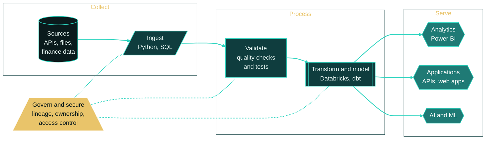

<p align="center">
  
</p>

<p align="center">
  
</p>

## About me

I'm a full-stack data engineer in Nairobi. I care about the whole journey data takes through a system: where it comes from, how it moves, how it changes along the way, and whether it can still be trusted when it arrives. Here's me, as a query:

```sql
SELECT role, focus, cares_about, community
FROM engineers
WHERE name = 'Celine Sitina'
  AND location = 'Nairobi, Kenya';
```

| role | focus | cares_about | community |
|---|---|---|---|
| Full-Stack Data Engineer | How systems work and move data, end to end | Data integrity, governance, and security | DAMA Kenya (Data Management Association) |

<sub>1 row returned. 0 rows failed validation.</sub>

### What I stand for

| Principle | What it means in my work |
|---|---|
| **Integrity** | Data should be as correct when it lands as when it left the source. Every pipeline should check its own data, not just move it. |
| **Governance** | Data needs clear ownership, definitions, and lineage, so people know where a number came from and can trust it. This is why I'm part of DAMA. |
| **Security** | Access to data should be deliberate. The right people see the right data, and sensitive data is protected at every stage. |

## How I work with data



<sub>Data moves left to right. Governance and security are not a final step: they watch every stage along the way.</sub>

## Tech stack

<table>
  <tr>
    <th>1. Ingest</th>
    <th>2. Transform and model</th>
    <th>3. Govern and secure</th>
    <th>4. Serve</th>
    <th>5. Deliver through apps</th>
  </tr>
  <tr>
    <td valign="top" align="center">
      <br/>
      <br/>
      
    </td>
    <td valign="top" align="center">
      <br/>
      <br/>
      
    </td>
    <td valign="top" align="center">
      <br/>
      <br/>
      <br/>
      
    </td>
    <td valign="top" align="center">
      <br/>
      <br/>
      <br/>
      
    </td>
    <td valign="top" align="center">
      <br/>
      <br/>
      <br/>
      
    </td>
  </tr>
  <tr>
    <td colspan="5" align="center">
      <sub>Running underneath it all</sub><br/>
      
      
      
    </td>
  </tr>
</table>

## Featured projects

<table>
  <tr>
    <td width="50%" valign="top">
      <a href="https://github.com/Sitina-Celine/REPLACE-F1-REPO">
        
      </a>
      <p>End-to-end pipeline that ingests Formula 1 data from the Ergast API, cleans and models it into analysis-ready tables, and keeps the data consistent from source to output.</p>
      
      
      
      
    </td>
    <td width="50%" valign="top">
      <a href="https://github.com/Sitina-Celine/REPLACE-FINANCE-REPO">
        
      </a>
      <p>Takes messy general ledger data and cleans it in Databricks so the finance numbers can be trusted, then serves it to a Power BI dashboard with DAX measures.</p>
      
      
      
      
    </td>
  </tr>
  <tr>
    <td width="50%" valign="top">
      <a href="https://github.com/Sitina-Celine/Sitina-Celine">
        
      </a>
      <p>A scheduled ETL job that runs this profile. It extracts the latest F1 result from an API, transforms it with Python, and loads it here every week. If the source fails, it keeps the last good result instead of loading bad data.</p>
      
      
      
      
    </td>
    <td width="50%" valign="top">
      <a href="https://github.com/Sitina-Celine/REPLACE-UKILI-REPO">
        
      </a>
      <p>A storefront where product, cart, and checkout data flows from Shopify's backend into a React front end, with Builder.io managing the page content.</p>
      
      
      
      
      
    </td>
  </tr>
</table>

## Live from my data pipeline

<p align="center">
  
  
  
</p>

```text
schedule  : every Monday, 06:00 UTC
extract   : Jolpica F1 API  (latest race)
validate  : skip the load if the source returns nothing
transform : Python  (top 3 finishers to Markdown)
load      : this README, between two hidden markers
on failure: keep last good result, never load bad data
```

[See the pipeline code](scripts/update_f1.py)

<!-- F1:START -->

**Brazilian Grand Prix** (season 2026, round 20, 2026-11-08)

| Pos | Driver | Team | Time / Status |
| --- | --- | --- | --- |
| 1 | Lando Norris | McLaren | 1:35:23.504 |
| 2 | Max Verstappen | Red Bull | +14.602 |
| 3 | Isack Hadjar | Red Bull | +24.485 |

<sub>Pipeline last ran: 2026-11-14 20:48 UTC. Source: Jolpica F1 API.</sub>

<!-- F1:END -->

## GitHub activity

<p align="center">
  
</p>

<p align="center">
  
</p>

<p align="center">
  <picture>
    <source media="(prefers-color-scheme: dark)" srcset="https://raw.githubusercontent.com/Sitina-Celine/Sitina-Celine/output/github-snake-dark.svg" />
    <source media="(prefers-color-scheme: light)" srcset="https://raw.githubusercontent.com/Sitina-Celine/Sitina-Celine/output/github-snake-light.svg" />
    
  </picture>
</p>

<details>
  <summary><b>Click here if you're a data engineer</b></summary>

```yaml
# Data quality tests that run on me every day
models:
  - name: celine_sitina
    columns:
      - name: curiosity
        tests:
          - not_null
      - name: approach
        tests:
          - unique
      - name: data
        tests:
          - not_null
          - accepted_values:
              values: ["validated", "governed", "secured"]
      - name: every_number
        tests:
          - relationships:
              to: ref('trusted_source')
```

</details>

## Let's connect

[](REPLACE-WITH-YOUR-LINKEDIN-URL)
[](REPLACE-WITH-YOUR-PORTFOLIO-URL)

<p align="center">
  
</p>
