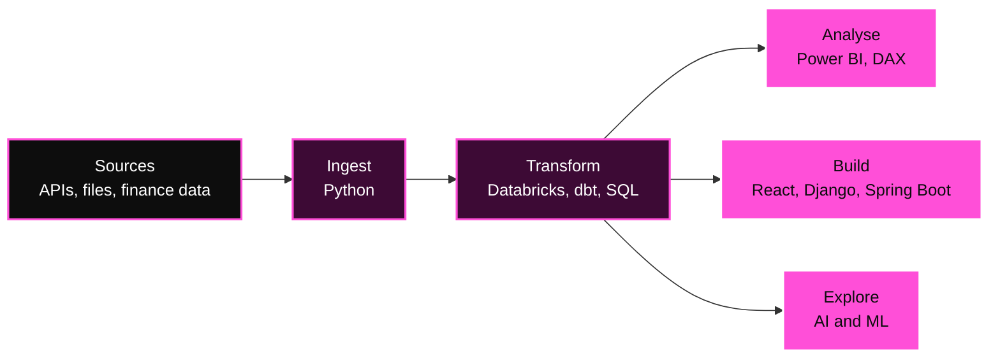

<p align="center">
  
</p>

<p align="center">
  
</p>

## About me

I'm a data engineer based in Nairobi, and I also build full-stack applications. I enjoy the whole journey of data: pulling it in from messy sources, cleaning and shaping it, and turning it into dashboards, apps, and machine learning work that people actually use.

- Currently building: an e-commerce storefront with React and Shopify
- Currently learning: Builder.io for visual page building
- Member of DAMA Kenya (Data Management Association)
- Interested in data platforms, analytics engineering, and AI/ML

## How I work with data



## Tech stack

**Ingest and transform**


**Analyse**


**Build**


**Explore (AI and ML)**


**Tools**


## Featured projects

<table>
  <tr>
    <td width="50%" valign="top">
      <h3><a href="https://github.com/Sitina-Celine/REPLACE-F1-REPO">Ergast F1 Data Pipeline</a></h3>
      <p>End-to-end pipeline that pulls Formula 1 data from the Ergast API, cleans and models it, and makes it ready for analysis.</p>
      <p><b>Stack:</b> Python, SQL, Databricks</p>
    </td>
    <td width="50%" valign="top">
      <h3><a href="https://github.com/Sitina-Celine/REPLACE-FINANCE-REPO">Finance Insights</a></h3>
      <p>Cleans raw general ledger data in Databricks and turns it into a Power BI finance dashboard with DAX measures.</p>
      <p><b>Stack:</b> Databricks, Power BI, DAX</p>
    </td>
  </tr>
  <tr>
    <td width="50%" valign="top">
      <h3><a href="https://github.com/Sitina-Celine/REPLACE-UKILI-REPO">UKILI Storefront</a></h3>
      <p>E-commerce storefront where a React app uses Shopify as its backend for products, cart, and checkout, with Builder.io for visual page editing.</p>
      <p><b>Stack:</b> React, TypeScript, Shopify, Builder.io</p>
    </td>
    <td width="50%" valign="top">
      <h3><a href="https://github.com/Sitina-Celine/Sitina-Celine">Self-Updating Profile Pipeline</a></h3>
      <p>This profile runs its own scheduled ETL job: GitHub Actions extracts the latest F1 race result from an API, transforms it with Python, and loads it into this page every week.</p>
      <p><b>Stack:</b> Python, GitHub Actions, REST API</p>
    </td>
  </tr>
</table>

## Live from my data pipeline

This section is updated automatically every Monday by a GitHub Action that runs a small ETL pipeline: it extracts the latest Formula 1 result from the Jolpica F1 API, transforms it with Python, and loads it here. [See the pipeline code](scripts/update_f1.py).

<!-- F1:START -->
Waiting for the first pipeline run.
<!-- F1:END -->

## GitHub activity

<p align="center">
  
  
</p>

<p align="center">
  
</p>

<p align="center">
  
</p>

<p align="center">
  <picture>
    <source media="(prefers-color-scheme: dark)" srcset="https://raw.githubusercontent.com/Sitina-Celine/Sitina-Celine/output/github-snake-dark.svg" />
    <source media="(prefers-color-scheme: light)" srcset="https://raw.githubusercontent.com/Sitina-Celine/Sitina-Celine/output/github-snake-light.svg" />
    
  </picture>
</p>

<details>
  <summary><b>Click here if you're a data engineer</b></summary>

```json
{
  "name": "Celine Sitina",
  "location": "Nairobi, Kenya",
  "role": "Data Engineer",
  "pipeline": ["extract", "clean", "model", "visualise", "ship"],
  "currently_building": "UKILI storefront",
  "currently_learning": "Builder.io",
  "favourite_query": "SELECT * FROM problems WHERE solved = FALSE"
}
```

</details>

## Let's connect

[](REPLACE-WITH-YOUR-LINKEDIN-URL)
[](REPLACE-WITH-YOUR-PORTFOLIO-URL)

<p align="center">
  
</p>
