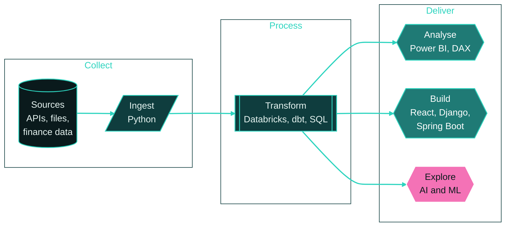
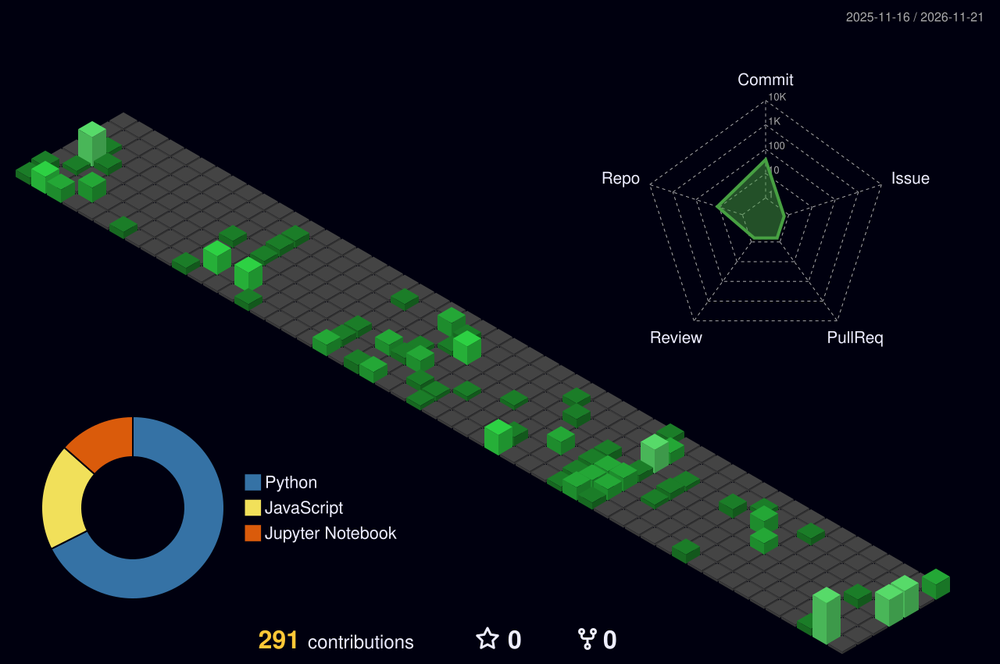

<p align="center">
  
</p>

<p align="center">
  
</p>

## About me

I'm a data engineer in Nairobi who also builds full-stack apps. Here's me, as a query:

```sql
SELECT role, focus, currently_building, currently_learning, community
FROM engineers
WHERE name = 'Celine Sitina'
  AND location = 'Nairobi, Kenya';
```

| role | focus | currently_building | currently_learning | community |
|---|---|---|---|---|
| Data Engineer and Full-Stack Builder | Data platforms, analytics engineering, AI/ML | UKILI, a React storefront on Shopify | Builder.io | DAMA Kenya |

<sub>1 row returned. Query time: a lifetime of curiosity.</sub>

## How I work with data



## Tech stack

<table>
  <tr>
    <th>1. Ingest</th>
    <th>2. Transform</th>
    <th>3. Analyse</th>
    <th>4. Build</th>
    <th>5. Explore</th>
  </tr>
  <tr>
    <td valign="top" align="center">
      <br/>
      
    </td>
    <td valign="top" align="center">
      <br/>
      
    </td>
    <td valign="top" align="center">
      <br/>
      <br/>
      
    </td>
    <td valign="top" align="center">
      <br/>
      <br/>
      <br/>
      <br/>
      <br/>
      
    </td>
    <td valign="top" align="center">
      
    </td>
  </tr>
  <tr>
    <td colspan="5" align="center">
      <sub>Running underneath it all</sub><br/>
      
      
      
    </td>
  </tr>
</table>

## Featured projects

<table>
  <tr>
    <td width="50%" valign="top">
      <a href="https://github.com/Sitina-Celine/REPLACE-F1-REPO">
        
      </a>
      <p>End-to-end pipeline that pulls Formula 1 data from the Ergast API, cleans and models it, and makes it ready for analysis.</p>
      
      
      
      
    </td>
    <td width="50%" valign="top">
      <a href="https://github.com/Sitina-Celine/REPLACE-FINANCE-REPO">
        
      </a>
      <p>Cleans raw general ledger data in Databricks and turns it into a Power BI finance dashboard with DAX measures.</p>
      
      
      
      
    </td>
  </tr>
  <tr>
    <td width="50%" valign="top">
      <a href="https://github.com/Sitina-Celine/REPLACE-UKILI-REPO">
        
      </a>
      <p>E-commerce storefront where a React app uses Shopify as its backend for products, cart, and checkout, with Builder.io for visual page editing.</p>
      
      
      
      
      
    </td>
    <td width="50%" valign="top">
      <a href="https://github.com/Sitina-Celine/Sitina-Celine">
        
      </a>
      <p>This profile runs its own scheduled ETL job: GitHub Actions extracts the latest F1 race result from an API, transforms it with Python, and loads it into this page every week.</p>
      
      
      
      
    </td>
  </tr>
</table>

## Live from my data pipeline

<p align="center">
  
  
  
</p>

```text
schedule  : every Monday, 06:00 UTC
extract   : Jolpica F1 API  (latest race)
transform : Python  (top 3 finishers to Markdown)
load      : this README, between two hidden markers
on failure: keep last good result, never break the page
```

[See the pipeline code](scripts/update_f1.py)

<!-- F1:START -->

**Brazilian Grand Prix** (season 2026, round 20, 2026-11-08)

| Pos | Driver | Team | Time / Status |
| --- | --- | --- | --- |
| 1 | Lando Norris | McLaren | 1:35:23.504 |
| 2 | Max Verstappen | Red Bull | +14.602 |
| 3 | Isack Hadjar | Red Bull | +24.485 |

<sub>Pipeline last ran: 2026-11-14 20:48 UTC. Source: Jolpica F1 API.</sub>

<!-- F1:END -->

## GitHub activity

<p align="center">
  
</p>

<p align="center">
  
</p>

<p align="center">
  <picture>
    <source media="(prefers-color-scheme: dark)" srcset="https://raw.githubusercontent.com/Sitina-Celine/Sitina-Celine/output/github-snake-dark.svg" />
    <source media="(prefers-color-scheme: light)" srcset="https://raw.githubusercontent.com/Sitina-Celine/Sitina-Celine/output/github-snake-light.svg" />
    
  </picture>
</p>

<details>
  <summary><b>Click here if you're a data engineer</b></summary>

```yaml
# Data quality tests that run on me every day
models:
  - name: celine_sitina
    columns:
      - name: curiosity
        tests:
          - not_null
      - name: approach
        tests:
          - unique
      - name: problems
        tests:
          - accepted_values:
              values: ["solved", "being_solved"]
      - name: data
        tests:
          - relationships:
              to: ref('decisions')
```

</details>

## Let's connect

[](REPLACE-WITH-YOUR-LINKEDIN-URL)
[](REPLACE-WITH-YOUR-PORTFOLIO-URL)

<p align="center">
  
</p>
