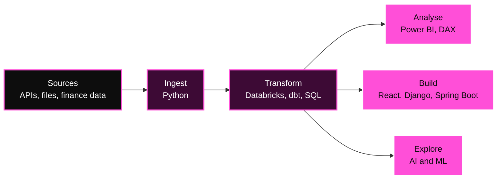

  

  

## About me

I'm a data engineer at Bizen Ltd in Nairobi, and I also build full-stack applications. I enjoy the whole journey of data: pulling it in from messy sources, cleaning and shaping it, and turning it into dashboards, apps, and machine learning work that people actually use.

- Currently building: an e-commerce storefront with React and Shopify
- Currently learning: Builder.io for visual page building
- Member of DAMA Kenya (Data Management Association)
- Interested in data platforms, analytics engineering, and AI/ML

## How I work with data

